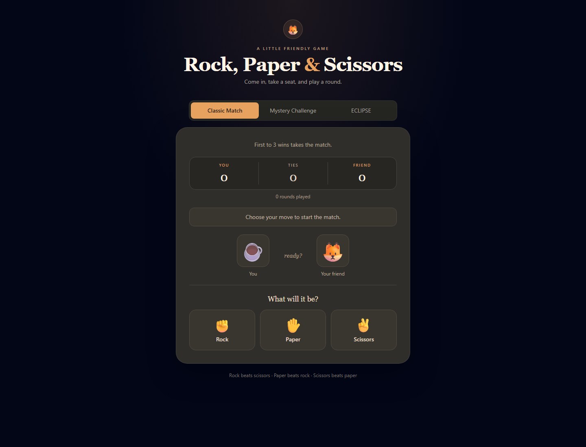
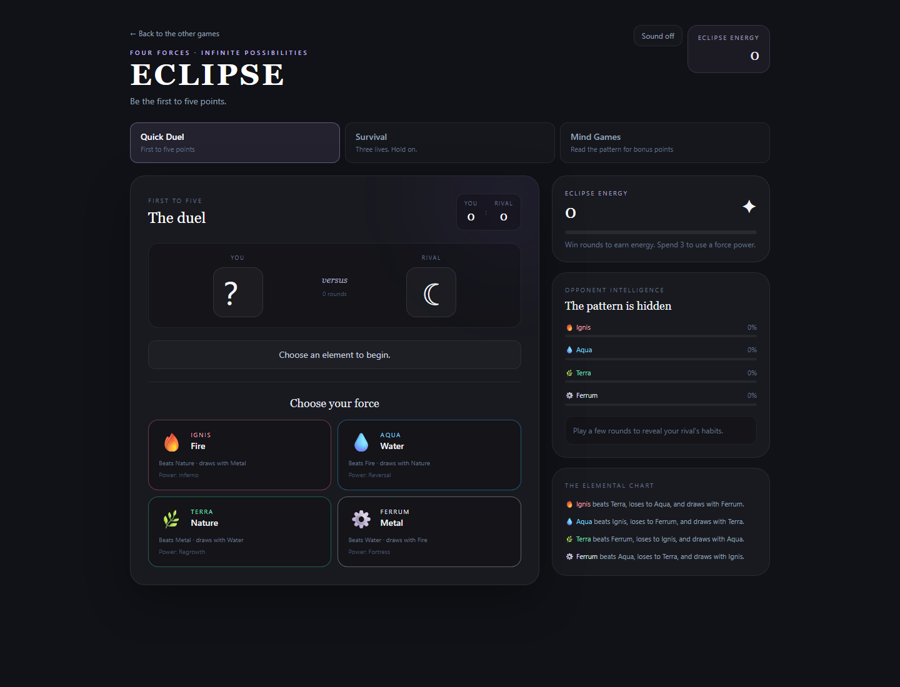
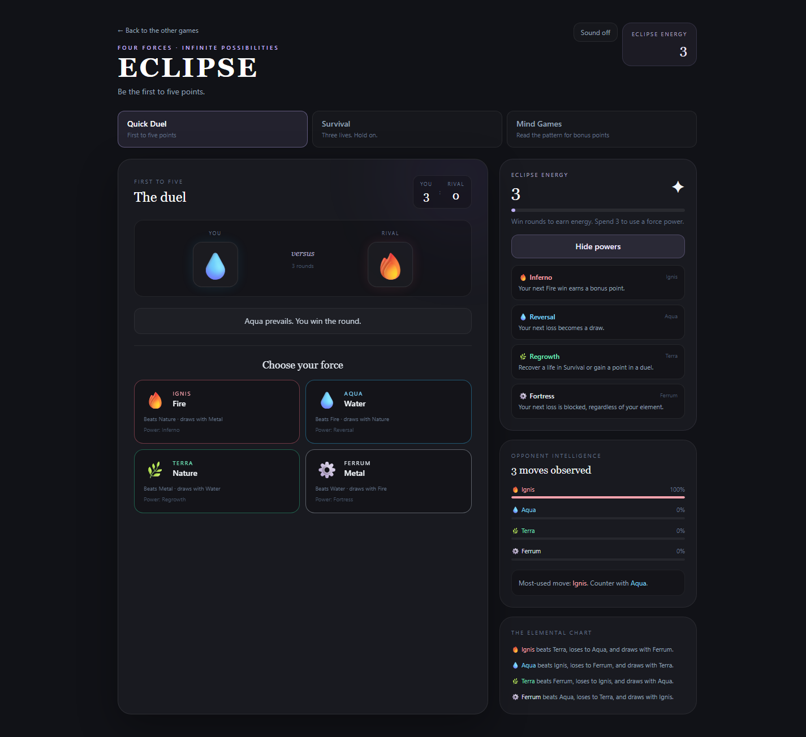

# Rock Paper Scissors

A polished, responsive game with classic Rock Paper Scissors and **ECLIPSE**—a strategy game of elemental matchups, opponent patterns, and energy-powered abilities.

## Screenshots

| Classic Match | ECLIPSE: Quick Duel |
|:--:|:--:|
|  |  |

**ECLIPSE powers and opponent intelligence**



## Game modes

### Classic Match

Play Rock, Paper, or Scissors. The first to three wins takes the match; ties do not award a point.

### Mystery Challenge

Try to reach a randomly chosen, hidden goal of three to seven wins. The goal is revealed when you reach it. Losses and ties do not end your run.

### ECLIPSE

Choose one of four forces and outthink the computer in one of three modes:

- **Quick Duel:** first to five points wins.
- **Survival:** start with three lives; see how long you can last.
- **Mind Games:** study the opponent’s choices and earn a bonus point by correctly countering its most-used force.

#### The four forces

| Force | Beats | Loses to | Draws with | Power |
|:--|:--|:--|:--|:--|
| 🔥 **Ignis** (Fire) | Terra | Aqua | Ferrum | **Inferno** — your next Fire win earns a bonus point. |
| 💧 **Aqua** (Water) | Ignis | Ferrum | Terra | **Reversal** — turn your next loss into a draw. |
| 🌿 **Terra** (Nature) | Ferrum | Ignis | Aqua | **Regrowth** — restore a Survival life or gain a point in a duel. |
| ⚙️ **Ferrum** (Metal) | Aqua | Terra | Ignis | **Fortress** — block your next loss. |

Matching forces draw. Each regular win earns one Eclipse energy. Spend three energy to activate a power; powers are optional, and the next eligible move triggers them.

## Run locally

### Requirements

- Node.js 20 or newer
- npm

### Install and start

```sh
npm install
npm run dev
```

Open the local URL printed by Vite.

## Development

```sh
npm test       # Run unit and UI tests
npm run lint   # Check lint rules
npm run build  # Type-check and create a production build
```

## Built with

React · TypeScript · Vite · Tailwind CSS · Vitest
